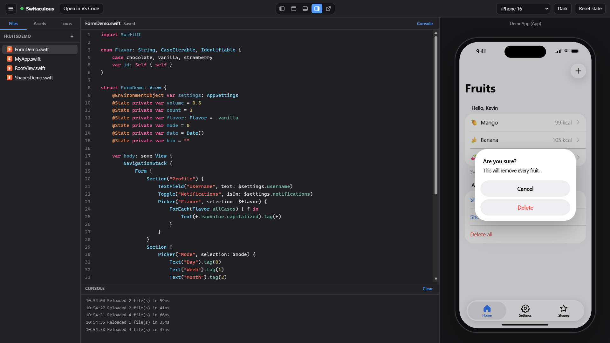

# Switaculous - Swift & SwiftUI Learning Editor

Switaculous lets you write Swift and SwiftUI code on Windows, Linux or a Mac and see it run in
a live iPhone or iPad preview in your browser. It is made for people who want to learn SwiftUI
before buying a Mac.

- Code editor on one side, live preview on the other. The preview updates as you type.
- The code you write is normal SwiftUI, so it opens and builds in Xcode without changes.
- The preview uses the iOS 26 Liquid Glass look, on iPhone and iPad screen sizes.
- Code completion, a file list, an image and colour library, and a system icon browser.
- Scan a QR code to try the app on your own iPhone or iPad over Wi-Fi.
- AI assistants such as Claude Code can work on your project through the built-in MCP server.
- One program with nothing else to install.



Switaculous is a learning tool, not a replacement for Xcode. It cannot build apps for a phone
and the preview is a close approximation, not a pixel-perfect copy. When you are ready to ship
an app, use Xcode.

## Install or run

Switaculous is always built on your own computer from this source code; no ready-made programs
or installers are downloaded. First get the code, either with Code > Download ZIP on GitHub
(then unzip it) or with `git clone`.

The install scripts do the rest. They download Go with curl if you don't have it, build
Switaculous, install it like any other app and start it. To install Go yourself instead, follow
[the Go installation guide](https://go.dev/doc/install) (Go 1.24 or newer).

### Windows

In the Switaculous folder, run:

```
powershell -ExecutionPolicy Bypass -File install.ps1
```

The script builds a standard Windows installer (MSI) and opens it. The installer adds
Switaculous to the Start menu, and its last page has a "Pin Switaculous to the taskbar" box that
is ticked by default. Windows 11 doesn't let installers pin apps, so there it tells you how to
pin it yourself (type Switaculous in Start, right-click it, choose Pin to taskbar).

The first time, the script also downloads the WiX toolset and the .NET SDK it runs on (about
250 MB, kept in `%LOCALAPPDATA%\Switaculous\build-tools`) to build the installer.

With Go installed you can also run it straight from the source, without installing:
`go run .`

### macOS

In the Switaculous folder, run:

```
bash install.sh
```

The script builds `Switaculous.app`, copies it to your Applications folder and offers to add it
to the Dock. With Go installed you can also run it straight from the source, without
installing: `go run .`

### Linux

In the Switaculous folder, run:

```
bash install.sh
```

The script builds a `.deb` package (Debian, Ubuntu, Mint) or an `.rpm` package (Fedora, Red Hat,
openSUSE), installs it with your package manager so Switaculous appears in your applications
menu, and offers to add it to your dock. The package it built stays in the `dist` folder.

With Go installed you can also run it straight from the source, without installing:
`go run .`

### Using Switaculous

Switaculous opens in your browser. The first time it creates a starter app in
`Documents/Switaculous/MyApp`; after that it opens the project you used last. Use the menu
button (three lines, top left) to:

- **Open Folder**: open any folder with Swift code, such as the folder next to an `.xcodeproj`.
- **New Project**: pick a name and a place to save it, and get a starter app.
- **Demos**: open one of the included example apps. They are copied to
  `Documents/Switaculous/Demos` the first time, so you can change them freely.
- **Recent Projects**: reopen one of the last ten projects.
- **Connect MCP** and **Connect iPhone / iPad**: see below.
- **Quit Switaculous**: stop the program. Your work is always saved.

The buttons in the middle of the top bar move the preview to the left, top, bottom or right of
the editor, or pop it out into its own window for a second screen. Close that window and the
preview goes back to where it was.

You can also start it with a project folder, for example `switaculous C:\Projects\MyApp`.
Use `switaculous -help` to see all options.

## What is supported

**Swift:** structs, classes, enums, protocols, extensions, generics, closures, optionals,
`if` and `switch` expressions, `async`/`await` and `Task`, and the standard library types
(String, Int, Double, Bool, Array, Dictionary, Set, Date, UUID and more) with their common
methods.

**SwiftUI views:** text, images, labels, stacks, grids, lists, forms, scroll views,
navigation (stack, split view, links, destinations), tab views, buttons, toggles, text fields,
pickers, sliders, steppers, date and colour pickers, menus, sheets, alerts, confirmation
dialogs, toolbars, search, swipe actions, context menus, shapes, gradients and materials.
About 250 modifiers are recognised, plus your own views, view modifiers and button styles.

**State:** `@State`, `@Binding`, `@Observable` with `@Bindable`, `@StateObject`,
`@ObservedObject`, `@EnvironmentObject`, `@Environment`, `@FocusState` and `@AppStorage`.

**SwiftData:** `@Model`, `@Query`, `ModelContainer`, `ModelContext`, `#Predicate`,
relationships and fetch descriptors. Data is saved in a real SQLite file in the project's
`.swiftdata` folder, and Xcode's SwiftData template runs unchanged.

**Saving and files:** `Codable` with `JSONEncoder` and `JSONDecoder`, `UserDefaults`,
`@AppStorage`, and reading JSON files from your project with `Bundle.main`.

**Photos and camera:** `PhotosPicker` uses your computer's file picker, and the usual
`UIImagePickerController` camera code uses your webcam.

**Assets:** images and colour sets in `Assets.xcassets`, including dark mode colours and
`AccentColor`. Add new ones from the Assets tab. The Icons tab lists the system icons the
preview can draw (about 400 common names and their variants).

**Not supported:** networking (`URLSession`), Core Data, maps, video, `Canvas` and
custom `Path` drawing, and UIKit views other than the photo and camera pickers. Switaculous
does not do Swift's full type checking, so a few mistakes that Xcode reports will still run
here. Xcode is always the final judge.

**On your iPhone or iPad:** choose Connect iPhone / iPad in the menu and scan the QR code with
the Camera app. The device must be on the same Wi-Fi. It can view and tap the app but cannot
read or change your files. Start Switaculous with `-local-only` to turn this off.

## Using with AI assistants

Switaculous includes an MCP server, so an AI assistant such as Claude Code can work on the
project you have open. It can read and write the Swift files, see errors, look at an outline
of the screen in the preview, tap buttons and type into fields to test its changes, and switch
devices. Everything it does shows up live in your editor and preview.

While Switaculous is open, the MCP server runs on the same port as the editor, at
`http://127.0.0.1:8642/mcp`. Choose Connect MCP in the menu to copy the exact command for your
port. To register it with Claude Code, run this once in a terminal:

```
claude mcp add --transport http switaculous http://127.0.0.1:8642/mcp
```

Or add it to a project's `.mcp.json` file:

```json
{
  "mcpServers": {
    "switaculous": {
      "type": "http",
      "url": "http://127.0.0.1:8642/mcp"
    }
  }
}
```

Then ask Claude something like "Add a settings screen with a dark mode toggle and check that
it works". The MCP server only accepts connections from your own computer.

The tools it offers are: `project_info`, `read_swift_file`, `write_swift_file`,
`delete_swift_file`, `preview_status`, `select_preview`, `set_device`, `tap`, `type_text`,
`reset_state`, `list_assets` and `search_api`.

## Releasing

The version lives in the [VERSION](VERSION) file. The app, `build-release.sh`, `install.sh`,
`install.ps1` and the Windows installer all read it, so nothing else needs editing. To cut a
release, start from a clean `main` and run:

```
go run ./tools/release 0.0.2          # updates VERSION, commits it and tags v0.0.2
go run ./tools/release -push 0.0.2    # the same, then pushes the commit and the tag
```

Then build the artifacts from that tag with `./build-release.sh` (and `install.ps1` or
`packaging/windows/build-msi.ps1` for the MSI). `build-release.sh` stops if the commit's tag and
VERSION disagree.

## Security

Please do not report security issues in public GitHub issues, as this might put users of the software at risk, instead, email me privately. See [SECURITY.md](SECURITY.md) for what to include and what
happens next.

## License and disclaimer

Switaculous is released under the MIT License; see [LICENSE](LICENSE). It includes CodeMirror,
SQLite and a few Go libraries under their own open source licenses; see
[THIRD_PARTY_NOTICES.md](THIRD_PARTY_NOTICES.md).

Switaculous is an independent learning project. It is not affiliated with, endorsed by or
sponsored by the makers of Swift, SwiftUI, iOS, iPadOS, iPhone, iPad or Xcode, and those names
belong to their respective owners. No proprietary code, fonts or icon artwork are included;
every icon is an original drawing.
